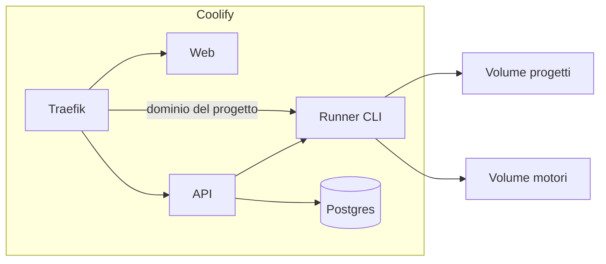

# Piano di sviluppo

Workspace web per progetti locali guidati da CLI di agenti (Claude Code, Cursor Agent, Gemini CLI) e da endpoint compatibili OpenAI. Si installa con Docker su Coolify. Traefik è il proxy di Coolify.

L’interfaccia è una sola per tutti i motori. Il processo della CLI resta il canale: la grafica invia messaggi e comandi, e disegna testo, tool, diff e conferme. I file si aprono in un editor con colori e indentazione automatica.

## Stack

| Pezzo | Scelta |
|---|---|
| UI | Vite, React, TypeScript, Tailwind, shadcn/ui, `vite-plugin-pwa` |
| Editor file | CodeMirror 6 tramite `@uiw/react-codemirror` |
| API | TypeScript, Hono, Postgres, Drizzle |
| Runner | Node: avvia le CLI, legge il flusso JSON, installa i pacchetti, tiene i server locali |
| Deploy | Docker Compose su Coolify |
| Domini | `app.tuodominio` per l’interfaccia. `*.preview.tuodominio` verso il runner, che smista in base all’host |

CodeMirror 6 è la libreria dell’editor. Il pacchetto base porta numerazione righe, undo, bracket matching e `indentOnInput`. I linguaggi arrivano dai pacchetti `@codemirror/lang-*` (JavaScript e TypeScript, JSON, HTML, CSS, Markdown, Python e gli altri che servono ai template). Il linguaggio si sceglie dal nome del file con `@codemirror/language-data`. Il tema legge le variabili di shadcn, così chiaro e scuro restano allineati al resto della UI. Monaco non entra: pesa quanto un IDE e qui l’editor è un pannello del progetto, non l’applicazione.

Su mobile la colonna progetti e quella laterale diventano pannelli. La sessione occupa lo schermo. Un file aperto passa a tutto schermo e si chiude tornando alla sessione. La PWA copre installazione e shell. La sessione richiede rete.

## Deploy

Servizi Compose:

- `web` — interfaccia statica
- `api` — autenticazione, progetti, giornale, GitHub
- `runner` — CLI, editor backend dei file, pacchetti, processi dei server locali
- `postgres`

Volumi persistenti: cartelle dei progetti, home dei motori, dati Postgres. Le CLI stanno solo nel runner. L’API e il runner parlano in rete interna.

Traefik termina TLS sui due domini configurati nel wizard. Il WebSocket della sessione passa da Traefik con timeout lungo, perché un turno può durare minuti. I domini dei progetti non creano un router Traefik ciascuno: un solo wildcard punta al runner, e il runner inoltra l’host alla porta del progetto.



## Schermata

```text
┌────────────┬──────────────────────────────┬─────────────────┐
│ Progetti   │  motore attivo            ▾  │  File           │
│            │                              │  Pacchetti      │
│ I miei     │  storico della sessione     │  Domini         │
│ Condivisi  │  testo, tool, diff          │                 │
│            │                              │  editor aperto  │
│ + Nuovo    │  [ messaggio, sempre attivo ]│  sul file       │
└────────────┴──────────────────────────────┴─────────────────┘
```

Desktop: tre colonne. Il click su un file apre CodeMirror nella colonna destra, sopra l’albero. La sessione non si sposta.

Mobile: sessione a tutto schermo. Progetti, file, pacchetti e domini si aprono dai pannelli. L’editor, quando è aperto, copre la sessione finché non lo chiudi.

## Regole di prodotto

**Motori.** Si registrano sull’istanza e valgono per ogni progetto. Più profili della stessa CLI convivono, ciascuno con la propria home. Accanto ci sono gli endpoint OpenAI (base URL, chiave, modello). Dalla barra si cambia motore in qualsiasi momento. Le bolle restano: sono lo storico del progetto. Il motore nuovo riceve il riepilogo. La sessione nativa di quel profilo resta nel suo volume, per riprenderla.

**Messaggi durante il lavoro.** Il composer non si blocca. Il testo entra nella sessione CLI già aperta e compare nello storico. Il turno in corso prosegue.

**Persone.** Ruoli sul progetto.

| Ruolo | Sessione | Editor file | GitHub | Membri |
|---|---|---|---|---|
| Owner | scrive | scrive | push, PR, impostazioni | invita e rimuove |
| Editor | scrive | scrive | push, PR | no |
| Viewer | legge lo storico | sola lettura | legge | no |

**Pacchetti.** Nella barra del progetto: installati e da installare. L’installazione finisce nell’ambiente di quella cartella. Tutti i membri del progetto usano le stesse librerie.

**Domini.** Un progetto dichiara comando, porta e host sotto il wildcard. Il runner avvia e ferma il processo. Chi ha accesso al progetto apre lo stesso indirizzo.

**GitHub.** La GitHub App si configura nel wizard. Da lì: clone alla creazione, branch in barra, commit e pull request con l’identità dell’utente.

## Modello dati

- Utente, sessione di login
- Progetto: path, repository, branch
- Membership: progetto, utente, ruolo
- Motore: tipo, nome, segreti cifrati, home
- Giornale: eventi del progetto (messaggio, tool, diff, motore, autore)
- Manifest pacchetti del progetto
- Route di preview: host, porta, comando, stato
- Nessuna copia dello storico nativo delle CLI: quello resta nel volume del motore

## Fasi

Le fasi 1–5 sono il primo rilascio. File ed editor, pacchetti e domini sono il secondo. GitHub operativo e la rifinitura PWA chiudono. shadcn si usa dalla fase 1.

### 1. Fondamenta

Repository, Compose, healthcheck, volumi, dominio Coolify, WebSocket attraverso Traefik, shell con layout desktop e mobile, manifest PWA.

Finito quando Coolify serve l’app su HTTPS e i dati sopravvivono a un riavvio.

### 2. Accesso e wizard

Admin, login, inviti. Il primo avvio chiede, in ordine: admin, GitHub App, cartella progetti, URL pubblico, dominio wildcard delle preview. Senza wizard completato non c’è workspace.

Finito quando un secondo utente entra e il wizard non si ripresenta.

### 3. Motori

Profili di istanza, più profili per la stessa CLI, endpoint OpenAI. Credenziali cifrate, home separata per profilo CLI. Azioni: aggiungi, ricollega, disattiva.

Finito quando Claude e un endpoint OpenAI risultano collegati e compaiono in ogni progetto.

### 4. Progetti e membri

Cartella per progetto, elenchi «miei» e «condivisi», ruoli owner, editor, viewer.

Finito quando due utenti vedono lo stesso progetto e solo owner ed editor possono modificarlo.

### 5. Sessione

Grafica unica: testo, tool, diff, conferma. Composer attivo durante l’esecuzione. Cambio motore con storico condiviso e riepilogo al motore nuovo. Giornale su Postgres.

Adattatori, in quest’ordine: Claude Code (`stream-json` in ingresso e in uscita), Cursor Agent, Gemini CLI, HTTP per le API OpenAI.

Finito quando due motori lavorano sullo stesso progetto, si può scrivere durante l’esecuzione e lo storico c’è ancora dopo un reload.

### 6. File ed editor

Albero confinata alla cartella del progetto. Il file si apre in CodeMirror 6.

L’editor include:

- colori in base al linguaggio del file
- indentazione automatica mentre si scrive, con tab e dimensione configurate nel progetto
- numerazione righe, undo, parentesi abbinate
- sola lettura per il viewer
- salvataggio sull’API, nello stesso path che la CLI legge
- tema allineato a shadcn

Su mobile l’editor è a tutto schermo. Un file binario o troppo grande resta scaricabile e non entra nell’editor.

Finito quando un file salvato dall’editor è quello che il motore legge al turno successivo, e un `.ts`, un `.py` e un `.json` si vedono colorati e indentati.

### 7. Pacchetti

Nella barra del progetto: installati e da installare. Manifest nel progetto, installazione eseguita dal runner nell’ambiente condiviso della cartella.

Finito quando un editor installa una libreria e un altro membro la trova già disponibile.

### 8. Server locali e domini

Comando, porta, dominio sotto il wildcard. Avvio e stop dal runner. Traefik inoltra l’host, il runner la porta.

Finito quando il dev server del progetto risponde su quel dominio da desktop e da telefono.

### 9. GitHub

Clone in creazione, branch in barra, commit e pull request con l’account GitHub dell’utente. La App è già configurata dalla fase 2.

Finito quando un progetto nasce da un repository e una modifica fatta in sessione o nell’editor diventa una pull request.

### 10. Chiusura PWA

Icone, service worker della shell, verifica dei pannelli mobile, sessione e editor usabili da telefono.

L’emulatore Android resta fuori da questo piano.

## Confine del primo rilascio

Si può lavorare su un progetto condiviso, con almeno un motore CLI e uno OpenAI, scrivendo anche mentre il motore è in esecuzione. File, editor, pacchetti, domini e pull request arrivano subito dopo, nell’ordine delle fasi 6–9.
